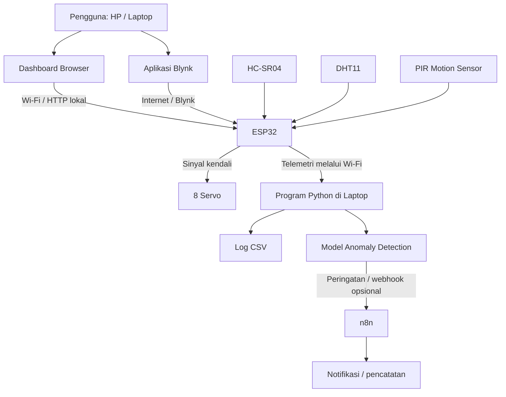
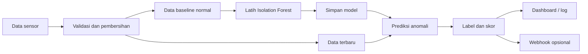
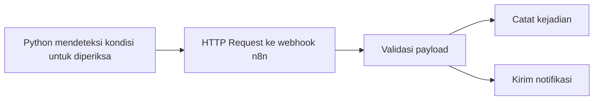

# VORTEX-X
## Dokumen Rancangan Lengkap dari Awal sampai Akhir

**Judul proyek:**  
**Rancang Bangun VORTEX-X: Robot Berkaki Empat Berbasis ESP32 dengan Kendali Real-Time, Monitoring Multi-Sensor, dan Integrasi AI melalui Otomatisasi IoT**

> **Status dokumen:** rancangan awal untuk prototipe mahasiswa. Harga komponen adalah perkiraan dan wajib dicek ulang sebelum membeli. Desain mekanik, rangkaian daya, dan gerakan harus diuji bertahap sebelum robot dijalankan penuh.

---

## Daftar Isi

1. [Gambaran Umum](#1-gambaran-umum)
2. [Tujuan dan Ruang Lingkup](#2-tujuan-dan-ruang-lingkup)
3. [Konsep dan Cara Kerja](#3-konsep-dan-cara-kerja)
4. [Fitur Utama](#4-fitur-utama)
5. [Arsitektur Sistem](#5-arsitektur-sistem)
6. [Daftar Komponen dan Anggaran](#6-daftar-komponen-dan-anggaran)
7. [Rancangan Mekanik](#7-rancangan-mekanik)
8. [Rancangan Elektronik dan Pin ESP32](#8-rancangan-elektronik-dan-pin-esp32)
9. [Aturan Keselamatan dan Daya](#9-aturan-keselamatan-dan-daya)
10. [Perangkat Lunak dan Struktur Folder](#10-perangkat-lunak-dan-struktur-folder)
11. [Tahapan Pembuatan dari Nol](#11-tahapan-pembuatan-dari-nol)
12. [Rancangan Firmware ESP32](#12-rancangan-firmware-esp32)
13. [Rancangan Dashboard Browser](#13-rancangan-dashboard-browser)
14. [Rancangan Blynk IoT](#14-rancangan-blynk-iot)
15. [Rancangan AI Lokal dengan Python](#15-rancangan-ai-lokal-dengan-python)
16. [Integrasi Otomatisasi dengan n8n](#16-integrasi-otomatisasi-dengan-n8n)
17. [Pengujian dan Evaluasi](#17-pengujian-dan-evaluasi)
18. [Masalah yang Mungkin Muncul](#18-masalah-yang-mungkin-muncul)
19. [Pengembangan Lanjutan](#19-pengembangan-lanjutan)
20. [Checklist Pengerjaan](#20-checklist-pengerjaan)
21. [Kesimpulan](#21-kesimpulan)

---

## 1. Gambaran Umum

VORTEX-X adalah rancangan robot berkaki empat (*quadruped robot*) yang dikendalikan menggunakan ESP32. Robot direncanakan memiliki delapan servo, yaitu dua servo pada setiap kaki, untuk menghasilkan gerakan dasar seperti berdiri, maju, mundur, dan berbelok.

Robot dilengkapi tiga sensor:
- **HC-SR04** untuk memperkirakan jarak objek di depan robot.
- **DHT11** untuk membaca suhu dan kelembapan lingkungan.
- **PIR (Passive Infrared)** untuk mendeteksi pergerakan manusia atau makhluk hidup di sekitar robot (misalnya HC-SR501 atau Mini PIR AM312).

ESP32 bertanggung jawab atas pembacaan sensor, kendali servo, koneksi Wi-Fi, dan aturan keselamatan lokal. Pengguna dapat memberi perintah melalui dashboard browser, gamepad/joystick interaktif, atau aplikasi Blynk. Laptop menjalankan program Python yang menyimpan data dan melakukan analisis anomali sederhana secara lokal.

**Catatan penting:** AI dalam versi awal bukan AI generatif. Sistem memakai pendekatan *anomaly detection* untuk menandai pola data sensor yang berbeda dari kondisi normal yang telah direkam. Hasil anomali bukan bukti pasti adanya bahaya atau penyusupan nyata.

### 1.1 Mengapa proyek ini menarik?

Proyek ini menggabungkan beberapa bidang:
- Sistem tertanam dan mikrokontroler.
- Robotika dan kendali servo.
- IoT dan dashboard.
- Pemrosesan data dengan Python.
- Machine learning sederhana.
- Otomatisasi notifikasi menggunakan webhook/n8n.

### 1.2 Batasan versi awal

Agar realistis untuk proyek mahasiswa:
- Gerakan awal dibatasi pada berdiri, maju, mundur, belok kiri, belok kanan, dan berhenti.
- Gerakan tidak dijamin berjalan mulus sebelum sudut servo dan mekanik dikalibrasi.
- Analisis AI dilakukan pada laptop, bukan langsung pada ESP32.
- Koneksi internet tidak boleh menjadi satu-satunya syarat agar robot bisa berhenti dengan aman.
- Sensor PIR bukan sistem keamanan militer/tersertifikasi dan pembacaan awal memerlukan waktu stabilisasi (*settling time*).
- Versi pertama tidak dirancang untuk operasi penyelamatan nyata.

---

## 2. Tujuan dan Ruang Lingkup

### 2.1 Tujuan

1. Merancang robot berkaki empat dengan delapan servo.
2. Menerapkan ESP32 sebagai pengendali utama.
3. Membaca tiga jenis sensor lingkungan.
4. Mengendalikan robot melalui browser dan Blynk.
5. Mengirim data sensor ke laptop melalui jaringan Wi-Fi.
6. Menyimpan data sensor dalam format CSV.
7. Menggunakan Python untuk mendeteksi pola sensor yang tidak biasa.
8. Menguji respons kendali, pembacaan sensor, dan keandalan sistem.

### 2.2 Ruang lingkup

| Bagian | Cakupan versi pertama |
|---|---|
| Penggerak | 8 servo mikro, 2 servo per kaki |
| Mikrokontroler | ESP32 DevKit V1 |
| Sensor jarak | HC-SR04 |
| Sensor lingkungan | DHT11 |
| Sensor gerak/manusia | PIR (HC-SR501 / AM312) |
| Kendali | Browser dan Blynk |
| AI | Python lokal, anomaly detection |
| Penyimpanan | CSV di laptop |
| Otomatisasi | n8n opsional |
| Daya servo | Catu daya eksternal terpisah dari USB ESP32 |
| Mekanik | Rangka ringan buatan sendiri |

### 2.3 Hal yang tidak dijanjikan

- Robot tidak otomatis menjadi robot penyelamat sungguhan.
- Sensor PIR hanya mendeteksi perubahan pancaran radiasi inframerah akibat pergerakan tubuh hangat (manusia/hewan), bukan mengukur jarak atau mengidentifikasi wajah.
- AI tidak dapat mengetahui bahaya dengan pasti hanya dari tiga sensor ini.
- Harga total dapat berubah menurut toko, ongkir, kualitas barang, dan alat yang sudah dimiliki.

---

## 3. Konsep dan Cara Kerja

### 3.1 Nama VORTEX-X

Nama **VORTEX-X** digunakan sebagai nama proyek/branding. Kepanjangan yang dapat dipakai untuk presentasi:

**Versatile Omni-Robot for Teleoperation, Exploration and eXpert AI**

Kepanjangan tersebut merupakan pilihan branding proyek, bukan nama standar teknis.

### 3.2 Alur kerja

1. Pengguna membuka dashboard browser atau aplikasi Blynk.
2. Pengguna menekan tombol gerak.
3. Perintah dikirim melalui Wi-Fi ke ESP32.
4. ESP32 memeriksa kondisi keselamatan, misalnya apakah ada halangan terlalu dekat.
5. Jika perintah diizinkan, ESP32 menggerakkan servo sesuai pola gerak yang telah dikalibrasi.
6. ESP32 membaca sensor secara berkala.
7. Data sensor dan status robot dikirim ke laptop.
8. Python menyimpan data dan menganalisis apakah pola sensor berbeda dari data normal.
9. Jika diperlukan, program mengirim webhook ke n8n untuk notifikasi atau pencatatan.

### 3.3 Prinsip keselamatan

**Kendali gerak dan berhenti darurat harus tetap dijalankan oleh ESP32.** Laptop, AI, Blynk, dan n8n merupakan sistem pendukung. Jika koneksi laptop atau internet terputus, ESP32 tetap harus mampu menghentikan gerakan berdasarkan aturan lokal.

---

## 4. Fitur Utama

### 4.1 Kendali melalui browser
Dashboard menyediakan tombol:
- Maju
- Mundur
- Belok kiri
- Belok kanan
- Berdiri
- Berhenti

Perintah dari browser dan Blynk harus masuk ke satu pengelola perintah di firmware. Jangan membuat dua mekanisme yang menggerakkan servo secara terpisah.

### 4.2 Kendali Blynk
Blynk digunakan untuk memantau sensor dan mengirim perintah melalui internet. Akses jarak jauh bergantung pada koneksi internet, konfigurasi Blynk, dan keamanan akun.

### 4.3 Penghentian saat ada halangan
Jika jarak HC-SR04 berada di bawah ambang awal, misalnya 10 cm, robot menolak perintah maju dan menghentikan gerakan maju. Ambang 10 cm hanya nilai awal untuk diuji; sesuaikan berdasarkan kecepatan, bentuk kaki, dan hasil pengujian.

### 4.4 Monitoring suhu dan kelembapan
DHT11 mengirim pembacaan suhu dan kelembapan ke dashboard dan log CSV. DHT11 cocok untuk demonstrasi dasar, bukan pengukuran presisi tinggi.

### 4.5 Monitoring respons Sensor PIR (Deteksi Gerak)
Sensor PIR mendeteksi pancaran gelombang inframerah termal dari manusia atau makhluk hidup yang bergerak di area pantau robot. Sinyal output berupa logika digital HIGH (1 = ada gerakan terdeteksi) dan LOW (0 = kondisi tenang). Modul seperti HC-SR501 memiliki pengaturan sensitivitas jarak dan *delay time*, sedangkan modul mini AM312 berukuran sangat ringkas dan hemat energi, sangat cocok dipasang di bagian moncong VORTEX-X untuk misi patroli, pemantauan ruangan, atau pencarian korban.

### 4.6 Analisis anomali AI lokal
Python dapat menggunakan Isolation Forest untuk menandai kombinasi data yang tidak biasa (misalnya kombinasi lonjakan suhu mendadak bersamaan dengan adanya deteksi gerakan saat robot berpatroli). Model dilatih menggunakan data baseline normal. Anomali perlu diperiksa manusia dan tidak otomatis berarti ada ancaman bahaya fatal.

### 4.7 Riwayat misi
Laptop menyimpan waktu, perintah gerak, jarak, suhu, kelembapan, status deteksi PIR (0 = aman, 1 = gerakan terdeteksi), status keselamatan, dan skor/label anomali jika tersedia.

---

## 5. Arsitektur Sistem



### 5.1 Fungsi setiap bagian

| Bagian | Tugas |
|---|---|
| Browser | Kontrol robot dan tampilan sensor |
| Blynk | Kontrol/monitoring jarak jauh |
| ESP32 | Kendali real-time, sensor, aturan keselamatan |
| Servo | Menggerakkan sendi kaki |
| Python | Menerima data, logging, inferensi anomali |
| CSV | Menyimpan rekaman data |
| n8n | Menghubungkan webhook dengan notifikasi/otomatisasi |

### 5.2 Pilihan koneksi

Untuk prototipe, tentukan satu metode komunikasi ESP32–Python dan implementasikan secara konsisten. Contoh:
- ESP32 mengirim HTTP POST ke server Python di laptop pada jaringan lokal; atau
- Python membaca endpoint/status ESP32 secara berkala.

Jangan menganggap alamat IP laptop selalu sama. Gunakan alamat IP lokal yang benar, dan bila perlu buat reservasi DHCP pada router.

---

## 6. Daftar Komponen dan Anggaran

### 6.1 BOM (Bill of Materials)

Perkiraan di bawah merupakan **anggaran perencanaan**, bukan harga final yang dijamin.

| No. | Komponen | Jumlah | Estimasi |
|---:|---|---:|---:|
| 1 | ESP32 DevKit V1 | 1 | Rp50.000 |
| 2 | Servo SG90 | 8 | Rp158.000 |
| 3 | HC-SR04 | 1 | Rp12.000 |
| 4 | DHT11 | 1 | Rp15.000 |
| 5 | Modul Sensor PIR (HC-SR501 / AM312) | 1 | Rp14.000 |
| 6 | Buzzer | 1 | Rp3.000 |
| 7 | Catu daya servo 5 V dengan kapasitas arus memadai | 1 | Rp46.000 |
| 8 | Kabel jumper, konektor, dan kabel daya | Secukupnya | Rp15.000 |
| 9 | Bahan rangka ringan | Secukupnya | Rp25.000 |
| 10 | Baut, mur, lem, pengikat | Secukupnya | Rp15.000 |
| 11 | Sakelar dan konektor dasar | Secukupnya | Rp5.000 |
| 12 | Ongkir/cadangan | — | Rp30.000 |
|  | **Subtotal elektronik dan mekanik** |  | **Rp388.000** |

Perkiraan alat kerja jika belum dimiliki:

| Alat | Estimasi |
|---|---:|
| Solder dan perlengkapan dasar | Rp138.000 |
| Multimeter dasar | Rp36.000 |
| Obeng/cutter/tang dasar | Rp25.000 |
| **Subtotal alat** | **Rp199.000** |
| **Total perkiraan jika membeli semuanya** | **Rp591.000** |

Harga bisa berbeda cukup besar. Servo SG90 sangat bervariasi kualitasnya. Pastikan catu daya mampu menangani arus lonjakan beberapa servo secara bersamaan; angka 5 V/5 A adalah titik awal untuk ditinjau, bukan jaminan selalu cukup.

### 6.2 Apakah bisa di bawah Rp300.000?

Jika harus membeli delapan servo, ESP32, tiga sensor, sumber daya, rangka, kabel, dan semua alat kerja dari nol, **Rp300.000 tidak realistis untuk rancangan penuh**.

Pilihan menekan biaya:
1. Pinjam solder, multimeter, dan alat mekanik dari laboratorium.
2. Gunakan bahan rangka sisa yang aman dan cukup kaku.
3. Mulai dengan dua kaki atau satu kaki untuk menguji servo, lalu lanjutkan setelah anggaran tersedia.
4. Buat versi demonstrasi empat servo, dengan konsekuensi mekanik dan gerakan lebih terbatas.
5. Tambahkan sensor dan AI setelah sistem gerak stabil.

Jangan mengurangi biaya dengan memasok semua servo langsung dari pin 5 V ESP32 atau USB laptop.

### 6.3 Prioritas pembelian

Urutan yang disarankan:
1. ESP32 dan satu servo untuk tes.
2. Catu daya yang sesuai dan multimeter.
3. Sensor HC-SR04.
4. Sisa servo dan bahan rangka.
5. DHT11 dan Sensor PIR.
6. Bahan pendukung dan konektor.
7. Integrasi dashboard, Python, dan n8n setelah perangkat keras stabil.

---

## 7. Rancangan Mekanik

### 7.1 Konsep kaki

Robot memiliki empat kaki:
- Depan kiri (FL)
- Depan kanan (FR)
- Belakang kiri (RL)
- Belakang kanan (RR)

Setiap kaki memiliki dua sendi yang digerakkan servo:
1. **Servo hip/ayun:** mengayunkan kaki ke depan dan belakang.
2. **Servo lift/angkat:** mengangkat dan menurunkan kaki.

### 7.2 Bahan rangka

Pilihan bahan:
- PVC foam board yang cukup tebal;
- akrilik ringan yang dipotong dengan alat yang sesuai;
- pelat plastik ringan;
- bracket servo siap pakai bila tersedia.

Hindari bahan yang terlalu lentur karena dapat membuat posisi servo berubah saat kaki menahan beban. Hindari rangka yang terlalu berat untuk SG90.

### 7.3 Perkiraan tata letak

```text
                 ARAH DEPAN
                      ↑
           FL                      FR
       [hip][lift]              [lift][hip]
             \                    /
              +------------------+
              | ESP32 + sensor   |
              | baterai/PSU      |
              +------------------+
             /                    \
       [hip][lift]              [lift][hip]
           RL                      RR
```

Diagram ini bersifat konseptual, bukan gambar ukuran produksi. Ukuran badan, jarak kaki, posisi pusat massa, panjang kaki, dan bracket harus ditentukan dari servo dan bahan yang benar-benar dibeli.

### 7.4 Urutan perakitan mekanik

1. Ukur servo yang dibeli dan tentukan dimensi badan.
2. Buat pola badan pada kertas/karton terlebih dahulu.
3. Tandai posisi empat kaki secara simetris.
4. Potong bahan rangka menggunakan alat yang sesuai.
5. Pasang servo dengan bracket atau dudukan yang kokoh.
6. Pasang horn servo saat servo berada pada posisi netral.
7. Hubungkan bagian kaki tanpa mengunci baut terlalu kencang.
8. Pastikan seluruh sendi bergerak bebas dan kabel tidak terjepit.
9. Letakkan ESP32 dan sensor di posisi terlindungi.
10. Uji kestabilan badan dengan servo belum diberi perintah gerak besar.

### 7.5 Kalibrasi mekanik

- Mulai dengan sudut netral yang aman, misalnya sekitar 90° sebagai titik awal.
- Jangan menganggap semua servo tepat pada 90° secara mekanis.
- Kalibrasikan setiap servo satu per satu.
- Gunakan rentang sudut kecil pada awal pengujian.
- Jika servo berdengung keras, panas, atau terus menekan ujung mekanik, matikan daya dan periksa pemasangan.

---

## 8. Rancangan Elektronik dan Pin ESP32

### 8.1 Pemetaan pin awal

Pemetaan berikut adalah rancangan awal yang harus diperiksa pada papan ESP32 yang benar-benar digunakan.

| Fungsi | Pin ESP32 |
|---|---|
| Servo FL hip | GPIO13 |
| Servo FL lift | GPIO14 |
| Servo FR hip | GPIO16 |
| Servo FR lift | GPIO17 |
| Servo RL hip | GPIO18 |
| Servo RL lift | GPIO19 |
| Servo RR hip | GPIO21 |
| Servo RR lift | GPIO22 |
| HC-SR04 TRIG | GPIO23 |
| HC-SR04 ECHO | GPIO32 melalui pembagi tegangan |
| DHT11 DATA | GPIO4 |
| PIR digital OUT | GPIO27 (atau GPIO34, level logika digital 3,3 V) |
| Buzzer | GPIO25 melalui driver bila arusnya melebihi kemampuan pin |

Pin digital OUT PIR mengeluarkan sinyal logika 3,3 V (HIGH = gerak terdeteksi, LOW = diam) yang aman dibaca langsung oleh GPIO ESP32 tanpa memerlukan konversi analog ADC yang rumit.

### 8.2 Sambungan daya servo

**Jangan memasok delapan servo dari pin 3V3 atau dari pin USB ESP32.**

Rancangan umum:
- Positif catu daya servo 5 V → kabel positif seluruh servo.
- Negatif catu daya servo → kabel GND seluruh servo.
- GND catu daya servo → GND ESP32 (ground bersama).
- Sinyal setiap servo → GPIO yang ditetapkan.
- ESP32 dapat tetap diberi daya dari USB saat pemrograman, dengan ground disatukan.

Periksa polaritas sebelum menyalakan. Gunakan kabel daya yang sesuai dan sambungan yang tidak mudah lepas. Jangan menghubungkan dua sumber tegangan positif secara sembarangan.

### 8.3 HC-SR04

- VCC → 5 V sesuai spesifikasi modul.
- GND → GND.
- TRIG → GPIO23.
- ECHO → GPIO32 **melalui pembagi tegangan** agar sinyal 5 V turun ke level yang aman bagi ESP32.

Contoh pembagi tegangan harus dihitung berdasarkan resistor yang tersedia dan tegangan aktual. Jangan sambungkan ECHO 5 V langsung ke GPIO ESP32.

### 8.4 DHT11

- VCC → sesuai modul (sering 3,3–5 V, cek versi modul).
- GND → GND.
- DATA → GPIO4.
- Modul DHT11 tertentu sudah memiliki resistor pull-up; periksa papan modul.

### 8.5 Sensor PIR (Deteksi Gerak Pasif)

Sensor PIR (seperti HC-SR501 atau Mini PIR AM312) berfungsi mendeteksi keberadaan atau pergerakan objek bersuhu tubuh (manusia/hewan):
- **VCC** → 5 V (untuk HC-SR501) atau 3,3–5 V (untuk modul mini AM312).
- **GND** → GND ESP32.
- **OUT** → GPIO27 (atau GPIO34). Sinyal OUT menghasilkan level tegangan logika 3,3 V (HIGH saat mendeteksi gerakan dan LOW saat tidak ada gerakan), sehingga langsung kompatibel dengan pin digital ESP32.
- **Pengaturan HC-SR501:** putar trimpot sensitivitas sesuai kebutuhan jarak deteksi (sekitar 3–7 meter). Putar trimpot delay ke arah minimum agar respons robot cepat dan tidak menahan status HIGH terlalu lama.
- Sensor PIR memerlukan periode stabilisasi (*warm-up / settling time*) sekitar 15–30 detik saat pertama kali diberi daya sebelum menghasilkan pembacaan yang stabil.

### 8.6 Buzzer

Jika buzzer membutuhkan arus yang melebihi kemampuan GPIO, gunakan transistor/driver dan resistor yang sesuai. Jangan menggerakkan beban berarus besar langsung dari GPIO.

---

## 9. Aturan Keselamatan dan Daya

1. **Catu daya servo terpisah:** servo dapat menarik arus besar, terutama saat mulai bergerak atau tertahan.
2. **Ground bersama:** GND ESP32 dan catu daya servo harus terhubung bersama agar sinyal kontrol memiliki referensi yang sama.
3. **Periksa polaritas:** salah polaritas dapat merusak perangkat.
4. **Tegangan input ESP32:** jangan memberi 5 V langsung ke pin GPIO.
5. **Hentikan bila macet:** jika servo panas, berdengung, atau rangka terjepit, putuskan daya.
6. **Kehilangan koneksi:** jika perintah tidak diterima dalam batas waktu tertentu, ESP32 harus masuk keadaan berhenti yang aman.
7. **PIR bukan sistem alarm keamanan tersertifikasi:** gunakan untuk eksperimen deteksi gerak, patroli robotik, dan pembelajaran IoT.
8. **Uji tanpa beban dahulu:** uji servo, sensor, dan logika satu per satu sebelum merakit penuh.
9. **Jauhkan jari dari sendi:** kaki robot dapat menjepit kulit saat servo bergerak.
10. **Jangan meninggalkan robot aktif tanpa pengawasan.**

---

## 10. Perangkat Lunak dan Struktur Folder

### 10.1 Perangkat lunak

- Arduino IDE atau PlatformIO untuk firmware ESP32.
- Driver USB/serial yang cocok dengan board.
- Browser modern untuk dashboard.
- Blynk IoT untuk kendali/monitoring.
- Python 3 untuk server telemetri dan model AI.
- Library Python: `flask` atau `fastapi`, `pandas`, `scikit-learn`, dan `joblib`.
- n8n opsional untuk otomasi webhook.
- Git opsional tetapi disarankan untuk version control.

### 10.2 Struktur folder

```text
VORTEX-X/
├── firmware/
│   ├── vortex_x.ino
│   ├── gait.cpp
│   ├── gait.h
│   ├── sensors.cpp
│   └── sensors.h
├── dashboard/
│   ├── index.html
│   ├── style.css
│   └── app.js
├── ai/
│   ├── server.py
│   ├── train_model.py
│   ├── predict.py
│   ├── requirements.txt
│   └── data/
│       └── sensor_log.csv
├── automation/
│   └── n8n_workflow_notes.md
└── docs/
    ├── wiring.md
    ├── assembly.md
    └── test_results.md
```

### 10.3 Setup Python

Buka terminal di folder `ai`, lalu buat virtual environment:

```bash
python -m venv .venv
```

Aktifkan di Windows PowerShell:

```powershell
.\.venv\Scripts\Activate.ps1
```

Jika aktivasi diblokir oleh kebijakan PowerShell, gunakan terminal Command Prompt:

```bat
.venv\Scripts\activate.bat
```

Buat `requirements.txt`:

```text
flask
pandas
scikit-learn
joblib
```

Instal:

```bash
python -m pip install -r requirements.txt
```

Jika memakai FastAPI, gunakan FastAPI dan Uvicorn sebagai alternatif; jangan mencampur dua rancangan server tanpa kebutuhan.

---

## 11. Tahapan Pembuatan dari Nol

### Tahap 1 — Perencanaan
1. Tentukan anggaran nyata.
2. Periksa alat yang bisa dipinjam dari laboratorium.
3. Pilih servo, catu daya, dan bahan rangka yang kompatibel.
4. Buat daftar belanja final setelah memastikan harga dan spesifikasi.

**Hasil tahap:** BOM final dan gambar rangka konseptual.

### Tahap 2 — Uji satu servo
1. Sambungkan satu servo ke catu daya yang sesuai.
2. Sambungkan GND catu daya dengan GND ESP32.
3. Sambungkan sinyal servo ke satu GPIO.
4. Unggah program uji dengan gerakan kecil.
5. Periksa arah gerak, suara, suhu, dan kestabilan daya.

**Hasil tahap:** satu servo bekerja tanpa reset ESP32 atau panas berlebihan.

### Tahap 3 — Uji delapan servo
1. Tambahkan servo satu demi satu.
2. Uji tiap servo secara terpisah.
3. Catat posisi netral setiap servo.
4. Pastikan catu daya tidak drop saat beberapa servo bergerak.
5. Batasi gerak jika ada servo tertahan.

**Hasil tahap:** tabel kalibrasi delapan servo.

### Tahap 4 — Bangun rangka
1. Buat badan dan kaki.
2. Pasang servo pada bracket.
3. Atur pusat massa.
4. Pastikan kabel tidak terseret atau tertarik.
5. Uji berdiri tanpa gerakan berjalan.

**Hasil tahap:** rangka dapat berdiri secara mekanis dengan gerakan sendi terbatas.

### Tahap 5 — Tambahkan sensor
1. Uji HC-SR04 dan pembagi tegangan ECHO.
2. Uji DHT11.
3. Uji Sensor PIR setelah waktu stabilisasi 20–30 detik (lambaikan tangan untuk memastikan pin OUT berubah menjadi HIGH).
4. Bandingkan hasil sensor dengan kondisi lingkungan nyata.
5. Tangani nilai sensor yang tidak valid atau pembacaan *noise*.

**Hasil tahap:** data sensor dapat dibaca dan ditampilkan melalui serial monitor.

### Tahap 6 — Buat pola gerak
1. Implementasikan `stand()`.
2. Implementasikan `stopRobot()`.
3. Implementasikan `moveForward()` dengan gerakan kecil.
4. Uji `moveBackward()`.
5. Uji belok kiri dan kanan.
6. Atur kecepatan dan urutan kaki secara bertahap.
7. Uji di permukaan datar, jauh dari tangga dan tepi meja.

**Hasil tahap:** gerak dasar yang dapat diulang, meskipun mungkin belum halus.

### Tahap 7 — Tambahkan aturan keselamatan
1. Jika jarak tidak valid, jangan izinkan gerak maju otomatis.
2. Jika jarak di bawah ambang, tolak perintah maju.
3. Jika kontrol tidak diperbarui melewati timeout, berhenti.
4. Tambahkan tombol berhenti yang mengalahkan semua perintah gerak.
5. Uji kondisi kehilangan Wi-Fi.

**Hasil tahap:** robot berhenti dengan aman pada kondisi yang ditentukan.

### Tahap 8 — Dashboard browser
1. Buat tombol perintah.
2. Buat tampilan jarak, suhu, kelembapan, dan status deteksi gerak PIR (Aman / Gerakan Terdeteksi).
3. Integrasikan kendali gamepad/joystick interaktif (Web Gamepad API & tombol virtual).
4. Kirim perintah melalui HTTP/WebSocket pada jaringan lokal.
5. Tampilkan status koneksi, visualisasi robot, dan pesan kesalahan.
6. Tambahkan timeout perintah untuk keamanan.
7. Uji dari laptop dan HP di jaringan yang sama.

**Hasil tahap:** robot dapat dikendalikan dari browser lokal dengan visual gamepad yang responsif.

### Tahap 9 — Blynk
1. Buat template/device pada Blynk.
2. Tentukan datastream untuk perintah dan sensor.
3. Hubungkan firmware ke Wi-Fi dan Blynk.
4. Arahkan perintah Blynk ke pengelola perintah yang sama dengan browser.
5. Uji apakah perintah browser dan Blynk tidak saling bertabrakan.

**Hasil tahap:** kendali dan monitoring Blynk bekerja.

### Tahap 10 — Python dan logging
1. Buat server penerima data.
2. Terima payload sensor dari ESP32.
3. Validasi format dan tipe data.
4. Tambahkan timestamp.
5. Simpan ke CSV.
6. Buat grafik dasar untuk memeriksa data.

**Hasil tahap:** data terekam dan dapat dianalisis.

### Tahap 11 — AI anomaly detection
1. Kumpulkan data kondisi normal dalam beberapa sesi.
2. Periksa data kosong, nilai ekstrem, dan gangguan sensor.
3. Latih model Isolation Forest pada fitur yang dipilih.
4. Simpan model dengan `joblib`.
5. Gunakan model untuk memberi skor anomali pada data baru.
6. Evaluasi false positive dan false negative secara manual.
7. Tampilkan hasil sebagai “normal” atau “perlu diperiksa”, bukan sebagai diagnosis bahaya.

**Hasil tahap:** model dapat memberi penanda anomali berdasarkan data yang tersedia.

### Tahap 12 — n8n (opsional)
1. Buat webhook pada n8n.
2. Kirim payload ringkas dari Python ketika aturan peringatan terpenuhi.
3. Tambahkan node untuk mencatat atau mengirim notifikasi.
4. Hindari mengirim notifikasi berulang terlalu cepat.
5. Uji webhook dengan data contoh sebelum menghubungkan robot.

**Hasil tahap:** alur otomatisasi menerima peringatan dan menjalankan tindakan yang ditentukan.

### Tahap 13 — Dokumentasi
1. Simpan diagram kabel yang benar-benar digunakan.
2. Catat versi firmware dan library.
3. Catat kalibrasi sudut servo.
4. Catat hasil pengujian.
5. Foto rangka dan perakitan.
6. Catat keterbatasan dan rencana pengembangan.

**Hasil tahap:** dokumentasi proyek yang dapat diulang oleh orang lain.

---

## 12. Rancangan Firmware ESP32

Bagian ini adalah spesifikasi perilaku, bukan firmware lengkap yang langsung siap dipasang ke semua rangkaian. Kode final bergantung pada versi board, library, pinout, jenis servo, dan metode komunikasi yang dipilih.

### 12.1 Modul firmware

| Modul | Tanggung jawab |
|---|---|
| `vortex_x.ino` | Inisialisasi, loop utama, Wi-Fi |
| `gait.h/.cpp` | Kalibrasi servo dan pola gerak |
| `sensors.h/.cpp` | Pembacaan sensor dan validasi |
| `safety` | Penghentian lokal dan timeout |
| `communication` | Browser/Blynk/telemetri |

### 12.2 Fungsi yang direncanakan

```cpp
void stand();
void moveForward();
void moveBackward();
void turnLeft();
void turnRight();
void stopRobot();

float readDistanceCm();
bool readEnvironment(float &temperature, float &humidity);
int readPirState(); // 1 jika terdeteksi gerakan, 0 jika kondisi diam/aman
void updateSafety();
void publishTelemetry();
```

Fungsi di atas adalah antarmuka rancangan. Implementasi sebenarnya perlu disesuaikan dengan library yang digunakan.

### 12.3 Prioritas perintah

Prioritas yang disarankan:
1. Berhenti darurat.
2. Aturan keselamatan lokal.
3. Timeout kontrol.
4. Perintah gerak pengguna.
5. Mode otomatis/patroli jika diaktifkan.

Perintah “berhenti” tidak boleh tertahan oleh animasi gerak yang sedang berjalan. Hindari fungsi gerak panjang yang memblokir seluruh loop terlalu lama; gunakan pengendalian berbasis waktu dan state machine bila memungkinkan.

### 12.4 Pseudocode loop

```text
inisialisasi pin, servo, sensor, Wi-Fi
atur semua servo ke posisi aman
status gerak = BERHENTI

selama perangkat aktif:
    perbarui koneksi dan terima perintah
    baca sensor secara berkala
    periksa jarak dan validitas data
    periksa timeout perintah

    jika tombol berhenti aktif:
        hentikan gerakan
    jika kontrol timeout:
        hentikan gerakan
    jika perintah MAJU dan jarak terlalu dekat:
        tolak perintah MAJU dan hentikan gerak maju
    selain itu:
        jalankan pola gerak sesuai perintah

    kirim telemetri secara berkala
```

### 12.5 Catatan kendali servo

- Kalibrasikan setiap servo, karena posisi horn dapat berbeda.
- Gunakan sudut aman dan rentang kecil terlebih dahulu.
- Hindari menggerakkan semua servo ke sudut ekstrem secara bersamaan.
- Uji satu gerakan pada satu waktu sebelum membuat gait penuh.
- Servo SG90 umumnya tidak memberikan umpan balik posisi aktual; perintah sudut bukan bukti bahwa sendi benar-benar mencapai sudut tersebut.

---

## 13. Rancangan Dashboard Browser

### 13.1 Elemen antarmuka

Dashboard minimum:
- Nama dan status VORTEX-X.
- Status Wi-Fi/ESP32.
- Tombol Maju, Mundur, Kiri, Kanan, Berdiri, Berhenti.
- Indikator jarak (radar ultrasonic).
- Indikator suhu dan kelembapan.
- Status deteksi gerak PIR (Aman / Peringatan Gerakan Manusia).
- Status keselamatan dan visualisasi status robot berkaki empat.
- Visual Gamepad Interaktif (Dual Joystick, D-Pad, indikator tombol fisik/virtual).
- Waktu pembaruan terakhir.
- Panel log perintah dan telemetri waktu nyata.

### 13.2 Prinsip desain

1. Tombol berhenti harus mudah ditemukan.
2. Tampilkan jika robot offline.
3. Jangan menampilkan data lama seolah-olah masih baru.
4. Beri indikator ketika perintah maju ditolak karena halangan.
5. Gunakan tampilan sederhana agar mudah dibaca dari HP.
6. Jangan menyimpan token Blynk rahasia di kode JavaScript yang dapat dilihat semua orang.

### 13.3 Komunikasi browser

Jika browser dan ESP32 berada pada jaringan lokal, dashboard dapat mengirim permintaan HTTP ke ESP32. Perhatikan:
- Alamat IP ESP32 dapat berubah.
- Browser mungkin membatasi permintaan lintas asal (*CORS*).
- Jangan membuka endpoint kontrol ke internet tanpa autentikasi dan pengamanan yang layak.
- Jika memakai server perantara, server harus memvalidasi perintah dan status perangkat.

---

## 14. Rancangan Blynk IoT

### 14.1 Datastream yang disarankan

Nama dan Virtual Pin berikut adalah contoh rancangan. Sesuaikan dengan versi antarmuka Blynk yang digunakan.

| Data | Tipe | Contoh fungsi |
|---|---|---|
| `V0` | Integer/string | Perintah gerak |
| `V1` | Double | Jarak cm |
| `V2` | Double | Suhu |
| `V3` | Double | Kelembapan |
| `V4` | Integer | Status deteksi PIR (0 = Aman, 1 = Gerakan) |
| `V5` | Integer/string | Status robot |
| `V6` | Integer | Status anomali |
| `V7` | Integer | Tombol berhenti |

### 14.2 Alur

1. ESP32 tersambung ke Wi-Fi.
2. ESP32 tersambung ke Blynk.
3. Sensor diperbarui secara berkala.
4. Nilai sensor dikirim ke datastream.
5. Ketika pengguna mengirim perintah, firmware memvalidasinya.
6. Semua perintah masuk ke satu state controller.
7. Perintah yang bertentangan dengan keselamatan ditolak.

### 14.3 Keamanan

- Jangan membagikan Auth Token.
- Jika token terlanjur dipublikasikan, ganti token.
- Gunakan akun dan jaringan yang aman.
- Ingat bahwa kendali lewat cloud bergantung pada internet; tombol berhenti lokal tetap harus tersedia.

---

## 15. Rancangan AI Lokal dengan Python

### 15.1 Apa yang dimaksud AI di proyek ini?

Model awal menggunakan *Isolation Forest*, yaitu metode machine learning yang membantu menemukan sampel yang berbeda dari pola data yang dipelajari. Model tidak “memahami” lingkungan seperti manusia dan tidak dapat memastikan bahwa suatu anomali adalah bahaya.

### 15.2 Fitur data

Fitur yang mungkin dipakai:
- `distance_cm`
- `temperature_c`
- `humidity_pct`
- `pir_state` (0 atau 1)

Fitur harus dinilai kualitasnya sebelum dipakai. Nilai sensor yang gagal dibaca perlu ditandai, bukan otomatis diubah menjadi angka normal.

### 15.3 Format CSV

Contoh header:

```csv
timestamp,command,distance_cm,temperature_c,humidity_pct,pir_state,safety_status,anomaly_score,anomaly_label
```

Contoh satu baris data hanya untuk menggambarkan format:

```csv
2026-10-21T12:00:00,STOP,42.5,29.0,68.0,1,SAFE,, 
```

Nilai di atas adalah contoh ilustratif, bukan hasil pengukuran perangkat nyata.

### 15.4 Pipeline AI



### 15.5 Contoh latihan model

Simpan sebagai `train_model.py`. Skrip ini mengasumsikan file CSV berisi kolom fitur dan data baseline yang cukup.

```python
from pathlib import Path
import joblib
import pandas as pd
from sklearn.ensemble import IsolationForest

DATA_PATH = Path("data/sensor_log.csv")
MODEL_PATH = Path("model.joblib")

FEATURES = [
    "distance_cm",
    "temperature_c",
    "humidity_pct",
    "pir_state",
]

df = pd.read_csv(DATA_PATH)
df = df[FEATURES].apply(pd.to_numeric, errors="coerce").dropna()

if len(df) < 30:
    raise ValueError(
        "Data terlalu sedikit. Kumpulkan lebih banyak data sensor yang valid."
    )

model = IsolationForest(
    n_estimators=150,
    contamination=0.05,
    random_state=42,
)
model.fit(df)

MODEL_PATH.parent.mkdir(parents=True, exist_ok=True)
joblib.dump(model, MODEL_PATH)
print(f"Model disimpan ke: {MODEL_PATH}")
```

**Catatan:** `contamination=0.05` adalah nilai awal yang harus dievaluasi, bukan persentase bahaya yang pasti. Model ini hanya dapat dilatih setelah data CSV benar-benar tersedia dan kolomnya cocok.

### 15.6 Contoh prediksi

Simpan sebagai `predict.py`:

```python
from pathlib import Path
import joblib
import pandas as pd

MODEL_PATH = Path("model.joblib")

FEATURES = [
    "distance_cm",
    "temperature_c",
    "humidity_pct",
    "pir_state",
]

model = joblib.load(MODEL_PATH)

# Ganti angka contoh dengan pembacaan sensor aktual yang sudah divalidasi.
sample = pd.DataFrame([{
    "distance_cm": 42.5,
    "temperature_c": 29.0,
    "humidity_pct": 68.0,
    "pir_state": 1,
}])

prediction = model.predict(sample[FEATURES])[0]
score = model.decision_function(sample[FEATURES])[0]

label = "PERLU DIPERIKSA" if prediction == -1 else "POLA UMUM"
print("Label:", label)
print("Skor model:", float(score))
```

Angka contoh di atas tidak boleh digunakan untuk menyimpulkan kondisi ruangan yang sebenarnya.

### 15.7 Keterbatasan model

- Model perlu data yang representatif.
- Perubahan suhu/kelembapan mendadak atau *false trigger* PIR saat robot berguncang dapat dianggap anomali.
- Model dapat menghasilkan alarm palsu atau melewatkan kondisi penting.
- Jangan gunakan model sebagai pengganti sistem keamanan industri/militer tersertifikasi.
- Simpan data pelatihan, versi model, dan hasil evaluasi agar eksperimen dapat diulang.

---

## 16. Integrasi Otomatisasi dengan n8n

n8n adalah alat otomasi alur kerja. n8n **bukan AI dengan sendirinya**. Pada proyek ini, Python melakukan analisis, kemudian n8n dapat mengatur notifikasi atau pencatatan.

### 16.1 Contoh alur



### 16.2 Payload contoh

```json
{
  "device": "VORTEX-X",
  "event": "sensor_anomaly",
  "timestamp": "2026-10-21T12:00:00",
  "distance_cm": 42.5,
  "temperature_c": 29.0,
  "humidity_pct": 68.0,
  "pir_state": 1,
  "message": "Pola sensor tidak biasa; periksa kondisi secara manual."
}
```

Data pada contoh payload bersifat ilustratif.

### 16.3 Aturan notifikasi

- Tambahkan jeda atau *cooldown* agar notifikasi tidak dikirim setiap pembacaan.
- Jangan mengirim informasi rahasia.
- Uji dengan payload palsu terlebih dahulu.
- Pastikan endpoint webhook tidak dapat disalahgunakan oleh pihak luar.
- Gunakan pesan “perlu diperiksa”, bukan klaim “pasti terjadi bahaya penyusupan”.

---

## 17. Pengujian dan Evaluasi

### 17.1 Rencana pengujian

| ID | Pengujian | Langkah | Kriteria awal |
|---|---|---|---|
| T01 | ESP32 hidup | Nyalakan board dan buka serial monitor | Tidak reset berulang |
| T02 | Satu servo | Gerakkan pada rentang sudut kecil | Gerak konsisten, tidak panas |
| T03 | Delapan servo | Uji satu per satu lalu kombinasi | Tidak terjadi drop daya berulang |
| T04 | HC-SR04 | Bandingkan jarak pada beberapa posisi | Pembacaan masuk akal dan invalid terdeteksi |
| T05 | DHT11 | Baca beberapa kali | Nilai valid dan pembacaan gagal ditangani |
| T06 | Sensor PIR | Beri waktu settling 20-30 detik, uji lambaian tangan | Logika 1 (gerakan) dan 0 (diam) terbaca benar |
| T07 | Stop darurat | Tekan stop saat robot bergerak | Gerakan dihentikan secepat desain memungkinkan |
| T08 | Halangan | Letakkan objek di depan robot | Perintah maju ditolak pada ambang yang ditetapkan |
| T09 | Wi-Fi terputus | Putuskan koneksi saat bergerak | Timeout lokal menghentikan gerakan |
| T10 | Browser | Kirim setiap perintah | Status perintah terlihat |
| T11 | Blynk | Kirim perintah dan cek telemetri | Perintah dan data tersinkron |
| T12 | CSV | Jalankan logging | Timestamp dan data tersimpan |
| T13 | AI | Uji data baseline dan variasi | Hasil dan kesalahan model dicatat |
| T14 | n8n | Kirim payload uji | Webhook diproses sesuai alur |

Kriteria kuantitatif harus disesuaikan setelah prototipe tersedia. Jangan menulis hasil lulus/gagal sebelum pengujian benar-benar dilakukan.

### 17.2 Metrik evaluasi

- Persentase perintah yang berhasil dijalankan.
- Waktu respons dari perintah hingga robot mulai bergerak.
- Persentase pembacaan sensor valid.
- Frekuensi reset ESP32.
- Lama operasi sebelum baterai/catu daya bermasalah.
- Jumlah alarm palsu dan anomali yang terlewat pada data uji.
- Stabilitas gerakan pada permukaan datar.

### 17.3 Template hasil uji

Salin tabel ini ke `docs/test_results.md` dan isi setelah pengujian:

| Tanggal | ID tes | Kondisi | Hasil aktual | Status | Catatan/perbaikan |
|---|---|---|---|---|---|
| YYYY-MM-DD | T01 | — | Belum diuji | Belum diuji | — |
| YYYY-MM-DD | T02 | — | Belum diuji | Belum diuji | — |

---

## 18. Masalah yang Mungkin Muncul

### 18.1 ESP32 restart saat servo bergerak
**Kemungkinan:** catu daya servo tidak cukup, ground tidak tersambung baik, atau gangguan listrik.

**Langkah:**
1. Matikan daya.
2. Periksa polaritas dan sambungan GND.
3. Pisahkan jalur daya servo dari sumber daya logika sesuai desain.
4. Periksa kapasitas catu daya dan kabel.
5. Uji satu servo lalu tambah bertahap.

### 18.2 Servo berdengung atau panas
**Kemungkinan:** sendi tertahan, sudut terlalu ekstrem, beban terlalu berat, atau servo rusak.

**Langkah:** matikan daya, lepaskan beban mekanik, cek horn, kalibrasi ulang, dan kurangi beban.

### 18.3 HC-SR04 membaca nilai aneh
**Kemungkinan:** objek miring/menyerap suara, kabel, catu daya, atau waktu tunggu pembacaan tidak tepat.

**Langkah:** uji pada objek datar, beberapa jarak, dan tangani timeout sebagai pembacaan tidak valid.

### 18.4 Sensor PIR sering memicu sinyal palsu (false trigger)
**Kemungkinan:** guncangan mekanik robot saat berjalan, modul belum selesai *settling time*, sensitivitas trimpot terlalu tinggi, atau terkena paparan cahaya matahari langsung/sumber panas internal.

**Langkah:** beri jeda warm-up 30 detik setelah robot aktif, turunkan sensitivitas trimpot HC-SR501 ke arah berlawanan jarum jam, dan pasang PIR menghadap ke depan bebas dari hembusan panas komponen internal.

### 18.5 Browser tidak terhubung
**Kemungkinan:** IP berubah, perangkat beda jaringan, endpoint salah, atau kebijakan CORS.

**Langkah:** cek IP ESP32, ping bila tersedia, pastikan kedua perangkat berada di jaringan yang dapat saling menjangkau, dan lihat serial log.

### 18.6 Blynk online tetapi perintah tidak bekerja
**Kemungkinan:** datastream/pin salah, callback tidak menangani nilai, atau aturan keselamatan menolak perintah.

**Langkah:** tampilkan perintah yang diterima pada serial monitor dan uji tiap virtual pin satu per satu.

### 18.7 Python tidak menerima data
**Kemungkinan:** alamat IP/port salah, firewall, format JSON berbeda, atau server tidak berjalan.

**Langkah:** uji server dengan payload manual, cek firewall jaringan lokal, dan validasi nama kolom.

### 18.8 AI sering memberi anomali
**Kemungkinan:** baseline terlalu sedikit, sensor belum stabil, data salah, atau parameter model tidak cocok.

**Langkah:** kumpulkan baseline tambahan, cek kualitas data, pisahkan fase pemanasan, dan evaluasi dengan data uji terpisah.

---

## 19. Pengembangan Lanjutan

Setelah versi dasar stabil, fitur berikut dapat ditambahkan secara bertahap:
1. Sensor jarak tambahan untuk sisi kiri/kanan.
2. Sensor IMU untuk mengukur kemiringan badan.
3. Kamera untuk eksperimen computer vision.
4. Algoritma gait yang lebih halus.
5. Dashboard dengan grafik waktu nyata.
6. Basis data SQLite untuk riwayat yang lebih rapi.
7. Pengujian model AI dengan beberapa metode dan metrik.
8. Sistem update firmware yang lebih aman.
9. Pengamanan autentikasi untuk dashboard lokal.
10. Mode simulasi sebelum gerak fisik dijalankan.

Jangan menambahkan banyak fitur sekaligus. Stabilkan sistem dasar sebelum memperluas ruang lingkup.

---

## 20. Checklist Pengerjaan

### Perencanaan
- [ ] Anggaran final ditentukan.
- [ ] Komponen dan spesifikasi diverifikasi.
- [ ] Alat yang bisa dipinjam sudah diidentifikasi.
- [ ] Sketsa mekanik dibuat.
- [ ] Pemetaan pin diperiksa.

### Elektronik
- [ ] Satu servo berhasil diuji.
- [ ] Semua servo diuji secara bertahap.
- [ ] Catu daya servo diuji.
- [ ] Ground bersama dipastikan.
- [ ] ECHO HC-SR04 menggunakan pembagi tegangan.
- [ ] Sinyal digital OUT PIR terhubung ke GPIO (level logika 3,3 V dipastikan aman).
- [ ] Tidak ada kabel terbuka atau polaritas terbalik.

### Mekanik
- [ ] Rangka tidak mudah melentur.
- [ ] Servo terpasang kokoh.
- [ ] Sudut netral dikalibrasi.
- [ ] Kabel tidak terjepit.
- [ ] Robot diuji pada permukaan datar.

### Firmware dan IoT
- [ ] Sensor terbaca.
- [ ] Fungsi stop bekerja.
- [ ] Timeout koneksi bekerja.
- [ ] Halangan dapat memblokir perintah maju.
- [ ] Browser dapat mengendalikan robot.
- [ ] Blynk dapat memantau dan mengirim perintah.

### AI dan otomatisasi
- [ ] Data CSV terkumpul.
- [ ] Data divalidasi.
- [ ] Model dilatih dari data nyata.
- [ ] Model diuji pada data terpisah.
- [ ] Hasil anomali tidak diklaim sebagai diagnosis bahaya.
- [ ] n8n (jika digunakan) diuji dengan payload contoh.

### Dokumentasi
- [ ] Foto perakitan tersedia.
- [ ] Diagram kabel diperbarui sesuai rangkaian nyata.
- [ ] Hasil pengujian dicatat.
- [ ] Keterbatasan ditulis.
- [ ] Versi kode dan library dicatat.

---

## 21. Kesimpulan

VORTEX-X dirancang sebagai prototipe robot berkaki empat berbasis ESP32 yang menggabungkan gerak servo, tiga sensor, kendali browser/Blynk, pencatatan data, dan analisis anomali lokal dengan Python. n8n dapat ditambahkan untuk otomatisasi notifikasi setelah alur utama stabil.

Pengerjaan terbaik adalah bertahap: mulai dari satu servo, lanjut ke seluruh servo, rakit rangka, uji sensor, bangun kendali lokal dan aturan keselamatan, lalu tambahkan browser/Blynk, logging Python, model AI, dan otomatisasi.

Dengan rancangan penuh dan seluruh alat dibeli dari nol, anggaran kemungkinan melampaui Rp300.000. Anggaran akhir harus dibuat berdasarkan komponen nyata dan kapasitas catu daya yang sesuai. Keselamatan kelistrikan, kalibrasi servo, serta pengujian berulang lebih penting daripada menambahkan fitur sebanyak mungkin sejak awal.

---

## Referensi teknis yang perlu diperiksa sebelum implementasi

Gunakan dokumentasi resmi versi terbaru untuk memastikan API dan spesifikasi sesuai perangkat yang dibeli:
- Dokumentasi Arduino-ESP32: https://docs.espressif.com/projects/arduino-esp32/
- Dokumentasi ESP32 dan datasheet: https://www.espressif.com/en/products/socs/esp32
- Dokumentasi Blynk: https://docs.blynk.io/
- Dokumentasi scikit-learn Isolation Forest: https://scikit-learn.org/stable/modules/generated/sklearn.ensemble.IsolationForest.html
- Dokumentasi pandas: https://pandas.pydata.org/docs/
- Dokumentasi Flask: https://flask.palletsprojects.com/
- Dokumentasi n8n: https://docs.n8n.io/

**Catatan akhir:** URL di atas adalah titik awal dokumentasi resmi. Cocokkan spesifikasi dengan modul yang dibeli dan jangan menganggap semua modul dengan nama sama memiliki rangkaian atau batas tegangan yang identik.
